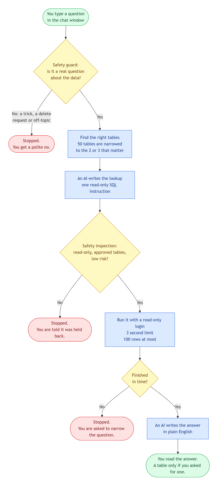

# Ask Your Data

**Ask questions about your company data in plain English. Get answers in plain English.**

## What is this?

Companies keep their numbers in a **database**: customers, orders, payments, staff, and more. To get an answer from a database, someone usually has to write code in a special language called SQL.

This project removes that step. You type a question, like a chat message. The app finds the answer and replies in a normal sentence.

> **You:** Who are our top 3 customers?
>
> **App:** The top three customers are Asha Rao (958.99), Mei Chen (59.99) and Ravi Kumar (44.00).

The app only **reads** data. It can never change or delete anything.

## What can it do?

- Answer questions typed in everyday words.
- Show a table, but only when you ask for one. For example: "Show me the top 3 customers in a table".
- Show how it found the answer (the SQL code). You can switch this on or off.
- Keep a list of your past chats, so you can open them again.
- Say no to bad requests, such as tricks, "delete everything", or questions about the weather.
- Protect private data. For example, it cannot see salaries.

## How does it work?

Think of a **careful librarian with a security guard at the door**. Here is the journey of one question:

<p align="center">
  
</p>

**Colours:** green = start and finish, blue = a step, yellow = a check, red = the question was stopped.


The same journey, in words:

1. **You ask** a question in the chat window.
2. **The guard checks it.** A fast safety AI called Jev decides if it is a real question about the data. Tricks and "delete" requests are stopped here.
3. **The librarian finds the right shelves.** The database has 50 tables (shelves). The app picks the 2 or 3 that matter.
4. **A second AI writes the lookup.** This is OpenAI. It writes one SQL instruction. It only sees the few shelves picked in step 3, never the whole database.
5. **The lookup is inspected.** It must be read-only, use only approved tables, and return at most 100 rows. The safety AI also gives it a risk score.
6. **It runs safely.** The app uses a database login that can only read. Any search that takes longer than 3 seconds is stopped.
7. **You get a sentence.** The AI writes the answer in plain English.

A normal answer takes about 3 to 7 seconds.

## What is in this folder?

| Folder | What it is |
|---|---|
| [`okf-crewai-service`](okf-crewai-service/README.md) | The "brain" behind the scenes. It does all the work above, using CrewAI agents and a knowledge bundle in Google's OKF format. |
| [`okf-chat-ui`](okf-chat-ui/README.md) | The chat window you type in. |
| [`okf_jev_requirement.md`](okf_jev_requirement.md) | The original plan and design notes. |

### Folder structure

```
OKF_JEV/
├── README.md                      This page: what the project is and how to start it
├── okf_jev_requirement.md         The detailed requirements and design notes
├── .gitignore                     Tells Git which files to leave out (secret keys, big folders)
├── docs/
│   ├── flowchart.png              The flow chart shown above
│   └── flowchart.mmd              The text the flow chart was drawn from
│
├── okf-crewai-service/            THE BRAIN: the backend that answers the questions
│   ├── src/okf_chat/              The program code (API, guards, navigator, SQL checks, agents)
│   ├── okf_bundle/                50 table descriptions in the Google OKF format
│   ├── db/                        SQL files that build the practice database
│   ├── tools/                     Live check scripts (they call the paid AI services)
│   ├── tests/                     Automatic checks, plus the lists of test questions
│   ├── .env.example               Template for your settings and secret keys
│   ├── pyproject.toml             The list of Python packages it needs
│   ├── Dockerfile, docker-compose.yml   Starts the service and the database
│   ├── HANDOFF.md                 Where the work stopped, decisions made, known limits
│   └── README.md                  The detailed guide for this service
│
└── okf-chat-ui/                   THE CHAT WINDOW: what you see in your browser
    ├── src/app/                   The chat window's code: chat, sidebar and history
    ├── public/                    Small files such as the page icon
    ├── package.json               The list of packages and the start commands
    ├── angular.json, tsconfig*.json   Settings for the Angular tool
    └── README.md                  The chat window guide
```

**Files that appear on your computer but are never uploaded to GitHub** (the `.gitignore` leaves them out on purpose):
- `okf-crewai-service/.env`: your secret keys and settings. You create it from `.env.example`.
- `okf-crewai-service/.venv/`: the Python packages for the backend.
- `okf-chat-ui/node_modules/`: the chat window's packages, created by `npm install`.
- Test results (`tests/last_run*.json`) and temporary folders such as `dist/` and `__pycache__/`.

## How the knowledge about the tables is stored

The backend learns what each table means from an **OKF bundle**. OKF is Google's [Open Knowledge Format](https://github.com/GoogleCloudPlatform/open-knowledge-format): a folder of plain Markdown files, one per table, each with a short YAML header. The files list the columns, keys, links to related tables and example questions.

The bundle is built from the real database by one command (`okf-chat build`), so it cannot drift from the real tables. You can edit the descriptions by hand, and later rebuilds keep your edits. The bundled `okf_bundle/` conforms to OKF v0.2; check it any time with `okf-chat check`.

## What you need before you start

1. **Two secret keys.** A key works like a password for an online service. You need one from each:
   - a **TypeSafe AI** key (for the safety AI), and
   - an **OpenAI** key (for the AI that writes the SQL and the answers).

   Both services charge a small amount for each question you ask. Keep your keys private.
2. **Docker Desktop.** It runs the practice database for you.
3. **Python 3.10 to 3.13.** The backend is written in Python.
4. **Node.js 20 or newer.** It is a free program that runs the chat window.

You also need an internet connection.

## Start it

Open a terminal (Command Prompt, PowerShell or Terminal) inside this project folder.

**Step 1.** Go to the backend folder and install it:
```
cd okf-crewai-service
python -m venv .venv
.venv\Scripts\pip install -e ".[dev]"
```
On Mac or Linux, use `.venv/bin/pip` instead.

**Step 2.** Make your settings file.
- Windows: `copy .env.example .env`
- Mac or Linux: `cp .env.example .env`

**Step 3.** Open the new `.env` file in any text editor and put in your two keys (`TYPESAFE_API_KEY` and `OPENAI_API_KEY`). Save the file.

**Step 4.** Start the practice database. It runs in Docker on port 5433:
```
docker compose up -d db
```

**Step 5.** Start the backend:
```
.venv\Scripts\okf-chat serve
```
On Mac or Linux, use `.venv/bin/okf-chat serve`. Wait until you see `Application startup complete`. Leave this window open. The backend now listens on **http://127.0.0.1:8001**.

(You can also run the backend in Docker: `docker compose up -d --build`.)

**Step 6.** Open a **second** terminal and start the chat window:
```
cd okf-chat-ui
npm install
npm start
```

**Step 7.** Open **http://localhost:4200** in your web browser. A **green dot** in the top-right corner means everything is ready. Type a question, for example: `Top 3 customers by total order value`.

**To stop:** press `Ctrl+C` in each terminal window. Then run `docker compose down` in `okf-crewai-service`.

The chat window's `apiUrl` (in `okf-chat-ui/src/app/environment.ts`) already points at port 8001. The full step-by-step guide, settings and troubleshooting are in the [backend guide](okf-crewai-service/README.md).

**Using your own database instead of the practice one?** See "Use it in another application" in the [backend guide](okf-crewai-service/README.md#use-it-in-another-application). The backend refuses to start if its database login can write, so give it a read-only login.

## Questions to try

**These should work:**
- `Top 3 customers by total order value`
- `How many employees do we have?`
- `Which products are below their reorder level?`
- `Show me the top 3 customers in a table`

**These will be politely refused:**
- `Delete all orders` (the app only reads data)
- `What is the weather today?` (not about your data)
- `What is the average salary?` (salary data is private)

The practice database is filled with made-up data. Odd names like "suppliers name 2" are normal.

## Good to know

- **Follow-ups work inside one chat.** Questions such as "show me in table view" or "and last month?" are understood. The backend remembers the last few messages for about 30 minutes, and forgets them when it restarts.
- **Check important answers.** The AI can make mistakes. Switch on **Show SQL query** in the sidebar to see exactly how an answer was found.
- **Your chats stay in your browser.** The chat history is saved only on your computer, not on a server. Use **Clear all history** on a shared computer.
- **Some data goes to OpenAI.** To write the answer, the app sends the result of your question (at most 30 rows) to OpenAI. If you do not want that, set `NATURAL_ANSWERS=0` in the `.env` file. The app then shows a table instead of a sentence.
- **It is practice data.** To use your own database, follow "Use it in another application" in the [backend guide](okf-crewai-service/README.md#use-it-in-another-application).

## Something not working?

| What you see | What to do |
|---|---|
| A **red dot** or "API offline" | The backend is not running. Do Step 4 again. |
| "This is taking too long" | The AI services are slow right now. Wait a moment and try again. |
| Every question gives an error | A key in `.env` is probably wrong or missing. Check both keys. |
| `docker` is not recognised | Install Docker Desktop and make sure it is running. |
| "Service refuses to start" about the database login | `DATABASE_URL` in `.env` must be the read-only login (`okf_readonly`, port 5433), not an admin one. |
| Something else | See the [backend guide](okf-crewai-service/README.md). |

## Keep your keys safe

- **Never upload your `.env` file** to GitHub or share it. It holds your secret keys. This project already hides it from Git. If a key is ever shared by mistake, delete it on the service's website and make a new one.
- The practice database uses a very simple password (`okf_readonly`). That is fine for learning. Change it before you connect real company data.

## For developers

Built with FastAPI (backend), Angular (chat window), PostgreSQL, a Google OKF v0.2 bundle as the knowledge layer, CrewAI agents with OpenAI for SQL and answers, TypeSafe Jev as the safety AI (it also scores which tables a question needs), and sqlglot to check every query. The technical details are in the [backend guide](okf-crewai-service/README.md) and the [chat window guide](okf-chat-ui/README.md).
